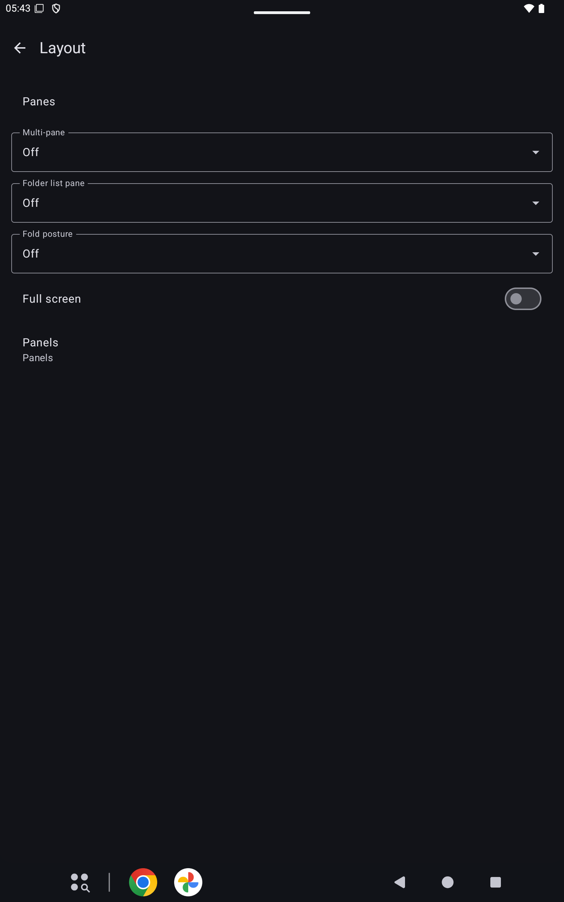

# Layout

Settings, Layout holds the pane choices. These controls will be pictured after the settings tree settles.

## Multi-pane

Multi-pane starts at Automatic (by screen size). On is the wide layout. Off stays one column regardless of width.

## Folder list pane

Folder list pane, Fold posture, and List and message arrangement use Automatic (by screen size), On, and Off where the tree has those three. Folder list pane also offers Own column and Above the list. List and message arrangement is Automatic (by screen size), Side by side, or List above message.

## Fold posture

Fold posture uses Off, On, and Automatic (by screen size). On stacks the panes when the device reports a horizontal hinge. No hinge leaves them side by side.

## Full screen

Full screen starts off. On hides the status bar and the navigation bar. A swipe shows them again.

## Custom panel layout

Custom panel layout is the editor shown when Layout is open and multi-pane is not Off.

## Change layout

Change layout applies the arrangement.

## Panels

Panels opens the five toolbar editors: the folder list, the message list, a selection, the reader, and compose.
